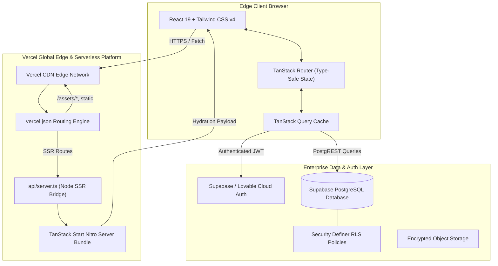

<div align="center">

# SoloOS — Financial Command System

### _The Financial Operating System for Independent Professionals_

[](https://solo-finance-command.vercel.app)
[](https://react.dev/)
[](https://www.typescriptlang.org/)
[](https://tanstack.com/)
[](https://supabase.com/)
[](https://tailwindcss.com/)
[](https://vercel.com/)

<br />

**Know what you earned. Know what you keep. Know what to do next.**

[Live Production Demo](https://solo-finance-command.vercel.app) • [Architecture](#-system-architecture) • [Getting Started](#-getting-started) • [Vercel Deployment](#-vercel-deployment-guide) • [Security & RLS](#-enterprise-security--compliance)

</div>

---

## 📑 Table of Contents

- [Executive Summary](#-executive-summary)
- [Core Philosophy & Financial Principles](#-core-philosophy--financial-principles)
- [System Architecture](#-system-architecture)
- [Feature Matrix](#-feature-matrix)
- [Technology Stack](#-technology-stack)
- [Repository Layout](#-repository-layout)
- [Getting Started](#-getting-started)
  - [Prerequisites](#prerequisites)
  - [Local Installation](#local-installation)
  - [Environment Configuration](#environment-configuration)
  - [Database Setup & Migrations](#database-setup--migrations)
- [Vercel Deployment Guide](#-vercel-deployment-guide)
  - [One-Click Vercel Deploy](#1-git-integration-recommended)
  - [Vercel CLI Deploy](#2-vercel-cli-deployment)
  - [Serverless SSR Runtime Mechanism](#3-serverless-ssr-runtime-mechanism)
- [Search Engine Optimization (SEO) & PWA](#-search-engine-optimization-seo--pwa)
- [Enterprise Security & Compliance](#-enterprise-security--compliance)
- [Scripts & Quality Assurance](#-scripts--quality-assurance)
- [Contributing](#-contributing)
- [License](#-license)

---

## 🧭 Executive Summary

**SoloOS** is an enterprise-grade financial operating system purpose-built for freelancers, consultants, creators, independent contractors, and solo businesses.

Traditional small-business accounting tools force independent professionals to juggle disconnected invoicing apps, spreadsheet trackers, generic accounting software, and ad-hoc tax estimates. SoloOS replaces this fragmented chaos with a single, calm, authoritative financial command center.

```
       Traditional Stack                           SoloOS Unified Command
┌───────────────────────────────┐              ┌─────────────────────────────┐
│ Separate Invoicing Tool       │              │                             │
│ + Spreadsheet Expense Tracker │              │           SoloOS            │
│ + Guesswork Tax Calculator    │  ───────►    │  Authoritative Financial    │
│ + Disconnected Bank Logins    │              │      Command System         │
│ + Fragmented Client Notes     │              │                             │
└───────────────────────────────┘              └─────────────────────────────┘
```

SoloOS continuously answers the nine questions that dictate independent business survival and growth:

1. **What do I have?** (Liquid cash reconciled in real time across accounts)
2. **What did I earn?** (Accurate accrual and cash-basis earnings)
3. **What did I actually keep?** (True net earnings after taxes, fees, and overhead)
4. **Who owes me?** (Outstanding receivables, age of debt, and cash-in timelines)
5. **Where is my money going?** (Categorized operational expenses and leakages)
6. **Which clients and projects are profitable?** (Real margins accounting for direct costs and effort)
7. **What obligations are coming?** (Upcoming vendor bills, subscriptions, and payouts)
8. **How much should I reserve for taxes?** (Dynamic, jurisdiction-aware tax reserve vault)
9. **How much can I safely spend?** (True safe-to-spend buffer preserving runway)

---

## ⚖️ Core Philosophy & Financial Principles

SoloOS is built on rigid, non-negotiable financial axioms:

### 1. The Fundamental Financial Loop

Every workflow in SoloOS enforces a closed feedback cycle:
$$\text{Capture} \longrightarrow \text{Understand} \longrightarrow \text{Decide} \longrightarrow \text{Act} \longrightarrow \text{Measure}$$

- **Capture:** Ingest financial events (invoices, receipts, payouts, adjustments).
- **Understand:** Translate raw events into authoritative double-entry-aligned state.
- **Decide:** Present clear, high-signal recommendations rather than raw ledger clutter.
- **Act:** Execute decisions (issue invoices, allocate tax reserves, send reminders).
- **Measure:** Quantify the exact impact on cash runway and net profit.

### 2. Financial Truth Comes First

- **Zero Mock Metrics:** No production screen ever displays hardcoded or estimated numbers.
- **Derived State:** Every metric on the Command Center derives mathematically from persisted, audited ledger events.
- **Single Source of Truth:** No competing or diverging calculations for revenue, expenses, or margins.

---

## 🏛️ System Architecture

SoloOS leverages an enterprise isomorphic architecture: React 19 + TanStack Start SSR on the edge, backed by Supabase PostgreSQL with non-recursive Row-Level Security (RLS) policies.



---

## 🚀 Feature Matrix

| Module                      | Capability                                                                                                                           | Business Outcome                                                                |
| :-------------------------- | :----------------------------------------------------------------------------------------------------------------------------------- | :------------------------------------------------------------------------------ |
| **Command Center**          | Live pulse of gross revenue, expenses, net profit, tax reserves, and runway.                                                         | Instant situational awareness with zero accounting jargon.                      |
| **Client & Project CRM**    | Multi-entity management, hourly/fixed billing scopes, historical client revenue.                                                     | Pinpoint your highest-value clients and eliminate unprofitable work.            |
| **Invoicing & Billing**     | Multi-currency invoice generator, automated numbering, state machine lifecycles (`draft` $\rightarrow$ `sent` $\rightarrow$ `paid`). | Accelerate payment collection and maintain professional audit trails.           |
| **Payment Ledger**          | Inflow and outflow reconciliation, partial payments, credit notes, and fee tracking.                                                 | Complete control over cash landing dates and clearing times.                    |
| **Expense Engine**          | Category breakdown (SaaS, contractor fees, travel, hardware), receipt attachments.                                                   | Maximize legal tax deductions and eliminate expense leakage.                    |
| **Tax Reserve Vault**       | Dynamic estimation of income tax, self-employment tax, and VAT/sales tax obligations.                                                | Never face surprise tax bills; funds are reserved before calculating take-home. |
| **Profitability Engine**    | Real-time margin analytics by client, project type, and calendar period.                                                             | Discover true effective hourly rates and project profitability.                 |
| **Cash Runway Forecaster**  | Burn-rate modeling, scheduled bills, safe-to-spend buffer calculator.                                                                | Confidently plan investments, equipment upgrades, and owner draws.              |
| **AI CFO Intelligence**     | Proactive alerts for late payments, anomaly detection, margin shifts, and tax dates.                                                 | An always-on algorithmic financial advisor for solo operators.                  |
| **Multi-Tenant Workspaces** | Granular RBAC (`owner`, `admin`, `finance`, `manager`, `viewer`) with multi-currency.                                                | Seamlessly manage multiple business entities or client accounts.                |

---

## 🛠️ Technology Stack

### Frontend & UI Layer

- **Framework:** [React 19](https://react.dev/) with Concurrent Mode and React Server integration.
- **Routing & SSR:** [TanStack Start](https://tanstack.com/start/latest) + [TanStack Router](https://tanstack.com/router/latest) with full type-safe route trees.
- **State & Data Synchronization:** [TanStack React Query v5](https://tanstack.com/query/latest) with optimistic updates and hydration caching.
- **Styling & Design System:** [Tailwind CSS v4](https://tailwindcss.com/) with CSS variables design tokens.
- **Component Primitives:** [Radix UI](https://www.radix-ui.com/) accessible unstyled headless primitives.
- **Icons & Visuals:** [Lucide React](https://lucide.dev/) consistent vector iconography.
- **Notifications & Dialogs:** [Sonner](https://sonner.emilkowal.ski/) toast system with accessibility compliance.

### Backend, Database & Infrastructure

- **Serverless SSR Engine:** [Nitro 3](https://nitro.unjs.io/) packaged for Vercel Node.js Serverless Functions (`api/server.ts`).
- **Database Engine:** [PostgreSQL](https://www.postgresql.org/) managed via [Supabase](https://supabase.com/).
- **Authorization & Security:** PostgreSQL Row-Level Security (RLS) with non-recursive `SECURITY DEFINER` authorization functions.
- **Identity & Authentication:** Supabase Auth (JWT) integrated with Lovable Cloud Auth.
- **Hosting & Edge Delivery:** [Vercel](https://vercel.com/) with immutable asset caching and HTTP security headers.

---

## 📂 Repository Layout

```
solo-finance-command/
├── api/
│   └── server.ts                 # Vercel Serverless Function bridge for TanStack Start SSR
├── public/
│   ├── favicon.svg               # Modern vector SVG favicon
│   ├── favicon.ico               # Legacy browser favicon fallback
│   ├── manifest.json             # Progressive Web App (PWA) manifest
│   ├── og-image.svg              # 1200x630 Open Graph card for social sharing & SEO
│   ├── robots.txt                # Search engine crawler policies and sitemap pointer
│   └── sitemap.xml               # Canonical XML sitemap for SEO discovery
├── src/
│   ├── components/
│   │   ├── app/                  # Application-specific layouts, shells, and context providers
│   │   │   ├── app-shell.tsx     # Command center navigation bar, drawer, and header
│   │   │   ├── state.tsx         # Empty, loading, and error UI state displays
│   │   │   └── workspace-context.tsx # Active workspace and profile context
│   │   └── ui/                   # Reusable Radix + Tailwind design system components
│   ├── domain/
│   │   └── workspace.ts          # Core domain models, enums, validation, and role helpers
│   ├── hooks/                    # Custom React hooks (auth, financial queries, media)
│   ├── integrations/
│   │   ├── lovable/              # Lovable cloud integration and error reporting
│   │   └── supabase/             # Supabase client, auth middleware, and typed schema
│   │       ├── client.ts         # Browser-side Supabase client
│   │       ├── client.server.ts  # Server-side Supabase client
│   │       └── types.ts          # Auto-generated database types
│   ├── lib/                      # Utilities (money formatting, auth, error capture)
│   │   ├── auth.tsx              # AuthProvider and session manager
│   │   ├── money.ts              # High-precision currency and ledger formatting
│   │   └── utils.ts              # ClassName merge and utility functions
│   ├── routes/                   # File-based TanStack Router route tree
│   │   ├── __root.tsx            # Root layout, HTML shell, SEO meta tags, and JSON-LD
│   │   ├── index.tsx             # Public landing page with SEO optimization
│   │   ├── auth.tsx              # Authentication portal (Sign In / Sign Up)
│   │   └── _authenticated/       # Protected application routes (RBAC & Auth guards)
│   │       ├── app.index.tsx     # Command Center primary dashboard
│   │       ├── app.settings.tsx  # Workspace settings, team roles, and currencies
│   │       ├── app.$module.tsx   # Dynamic modular feature route handler
│   │       └── onboarding.tsx    # First-time workspace creation wizard
│   ├── routeTree.gen.ts          # Auto-generated type-safe route tree
│   ├── router.tsx                # TanStack Router instance creation
│   ├── server.ts                 # TanStack Start SSR server entrypoint
│   ├── start.ts                  # Client hydration bootstrap
│   └── styles.css                # Global Tailwind CSS v4 stylesheets & font imports
├── supabase/
│   └── migrations/               # Production SQL migrations (Tables, RLS, Functions)
├── package.json                  # Dependencies, build, and lint scripts
├── tsconfig.json                 # TypeScript strict compiler configuration
├── vercel.json                   # Vercel deployment, rewrites, and security headers
└── vite.config.ts                # Vite bundler, TanStack Start, and Tailwind plugins
```

---

## ⚡ Getting Started

### Prerequisites

- **Node.js:** `v20.10.0` or higher (LTS recommended)
- **Package Manager:** `npm` (v10+), `pnpm` (v9+), or `bun` (v1.1+)
- **Supabase Project:** A Supabase account and active PostgreSQL instance

### Local Installation

1. **Clone the repository:**

   ```bash
   git clone https://github.com/GeoffreyPaul3/solo-finance-command.git
   cd solo-finance-command
   ```

2. **Install project dependencies:**

   ```bash
   npm install
   ```

3. **Configure environment variables:**
   Create a local `.env` file in the project root:

   ```bash
   cp .env.example .env # or edit .env directly
   ```

4. **Launch the development server:**
   ```bash
   npm run dev
   ```
   Open [http://localhost:3000](http://localhost:3000) (or the port shown in your terminal) in your browser.

---

### Environment Configuration

| Variable                    | Description                                 | Required | Default / Format                  |
| :-------------------------- | :------------------------------------------ | :------: | :-------------------------------- |
| `VITE_SUPABASE_URL`         | Supabase project API gateway URL            | **Yes**  | `https://<ref>.supabase.co`       |
| `VITE_SUPABASE_ANON_KEY`    | Supabase public anonymous API key           | **Yes**  | `eyJhbGciOiJIUzI1NiIsInR5cCI6...` |
| `SUPABASE_SERVICE_ROLE_KEY` | Supabase privileged server key (SSR / Edge) | Optional | `eyJhbGciOiJIUzI1NiIsInR5cCI6...` |
| `LOVABLE_API_KEY`           | Lovable cloud error reporting & telemetry   | Optional | `lovable_live_...`                |
| `NODE_ENV`                  | Runtime execution environment               |    No    | `development` / `production`      |

---

### Database Setup & Migrations

SoloOS schemas and RLS policies are version-controlled in `supabase/migrations/`:

```bash
# Link your local CLI to your remote Supabase project
npx supabase link --project-ref <your-project-ref>

# Apply the authoritative migrations
npx supabase db push
```

The database includes:

- `profiles`: User account details and onboarding status.
- `workspaces`: Multi-tenant business entities with timezone, currency, and fiscal year settings.
- `workspace_members`: Granular membership mappings with `app_role` enums.
- Non-recursive helper functions: `is_workspace_member(UUID)`, `has_workspace_role(UUID, app_role[])`, `current_workspace_role(UUID)`.

---

## 🚀 Vercel Deployment Guide

SoloOS is engineered for native, zero-downtime deployment on the **Vercel Global Edge Network**.

### 1. Git Integration (Recommended)

1. Push your repository to **GitHub**, **GitLab**, or **Bitbucket**.
2. Log in to [Vercel](https://vercel.com) and click **"Add New Project"**.
3. Import the `solo-finance-command` repository.
4. Set the project configuration:
   - **Framework Preset:** `Other` (or auto-detected Vite)
   - **Build Command:** `npm run build`
   - **Output Directory:** `dist/client`
   - **Install Command:** `npm install`
5. Add the Environment Variables:
   - `VITE_SUPABASE_URL`
   - `VITE_SUPABASE_ANON_KEY`
6. Click **Deploy**. Vercel will build the client distribution and deploy the serverless SSR runtime function.

### 2. Vercel CLI Deployment

Deploy directly from your terminal using the official Vercel CLI:

```bash
# Authenticate and link project
npx vercel link

# Pull remote environment variables
npx vercel env pull .env

# Deploy to production
npx vercel --prod
```

### 3. Serverless SSR Runtime Mechanism

SoloOS bridges modern TanStack Start isomorphic SSR into Vercel's serverless environment via `api/server.ts` and `vercel.json`:

```json
{
  "$schema": "https://openapi.vercel.sh/vercel.json",
  "version": 2,
  "outputDirectory": "dist/client",
  "buildCommand": "npm run build",
  "installCommand": "npm install",
  "functions": {
    "api/server.ts": {
      "includeFiles": "dist/server/**",
      "maxDuration": 30
    }
  },
  "rewrites": [
    {
      "source": "/((?!assets/|favicon\\.(?:ico|svg)|og-image\\.svg|manifest\\.json|robots\\.txt|sitemap\\.xml).*)",
      "destination": "/api/server"
    }
  ]
}
```

- **Static Cache:** All compiled assets in `/assets/` are served with `Cache-Control: public, max-age=31536000, immutable`.
- **Dynamic SSR:** All non-asset routes route through `api/server.ts`, which dynamically imports `dist/server/server.js` and streams HTML with instant hydration.
- **Zero-Missing-Bundle Assurance:** The `includeFiles: "dist/server/**"` directive guarantees that Vercel traces and includes the complete SSR server bundle in the lambda package.

---

## 🔍 Search Engine Optimization (SEO) & PWA

SoloOS implements elite Technical SEO best practices to ensure high search rank, rich social previews, and PWA capabilities:

1. **Structured Data (JSON-LD):**
   - Implements Google-compliant `SoftwareApplication` and `WebApplication` schemas in `src/routes/__root.tsx`.
   - Outlines price tier, supported currencies, operating system requirements, and feature sets for Google Rich Snippets.
2. **Social Graph Optimization:**
   - Dynamic Open Graph (`og:title`, `og:description`, `og:image`, `og:type`, `og:site_name`) tags.
   - Twitter Summary Cards with large image previews (`twitter:card`, `twitter:image`).
   - High-contrast 1200x630 vector social banner located at `/og-image.svg`.
3. **Crawlability & Indexing:**
   - `public/robots.txt` explicitly allows public marketing and auth pages while barring search spiders from private workspace URLs (`/app/*`, `/onboarding`).
   - `public/sitemap.xml` provides search bots with prioritized XML discovery URLs.
   - Canonical links (`rel="canonical"`) prevent duplicate content dilution.
4. **Progressive Web App (PWA):**
   - Web App Manifest (`public/manifest.json`) supporting standalone fullscreen installation on iOS and Android.
   - Adaptive `theme-color` meta tags matching system dark/light modes.

---

## 🛡️ Enterprise Security & Compliance

SoloOS treats financial data security with enterprise rigor:

```
┌────────────────────────────────────────────────────────────────────────┐
│                        Enterprise Security Stack                       │
├────────────────────────────────────────────────────────────────────────┤
│  HTTP Transport   │ Strict-Transport-Security (HSTS), TLS 1.3          │
│  Security Headers │ nosniff, DENY framing, XSS protection, CSP         │
│  Access Control   │ PostgreSQL RLS with SECURITY DEFINER validation    │
│  Role Hierarchy   │ Owner > Admin > Finance > Manager > Viewer         │
│  Data Isolation   │ Strict multi-tenant workspace partitioning         │
│  Input Validation │ Zod schema validation across all inputs and forms   │
└────────────────────────────────────────────────────────────────────────┘
```

### PostgreSQL Row-Level Security (RLS)

Data access is enforced at the database kernel level:

- Every table row references `workspace_id` or `user_id`.
- Access is gated through non-recursive `SECURITY DEFINER` functions:
  ```sql
  CREATE OR REPLACE FUNCTION public.is_workspace_member(_workspace_id UUID)
  RETURNS BOOLEAN LANGUAGE sql STABLE SECURITY DEFINER SET search_path = public AS $$
    SELECT EXISTS (
      SELECT 1 FROM public.workspace_members m
      WHERE m.workspace_id = _workspace_id AND m.user_id = auth.uid()
    );
  $$;
  ```
- Members can never query or manipulate records belonging to another workspace, even with compromised client tokens.

---

## 🧪 Scripts & Quality Assurance

SoloOS includes an automated suite of scripts for local validation and production readiness:

```bash
# Start local development server with HMR
npm run dev

# Compile client and server bundles for production
npm run build

# Run Vite in development build mode
npm run build:dev

# Preview production build locally
npm run preview

# Run ESLint across entire repository
npm run lint

# Format code with Prettier
npm run format
```

---

## 🤝 Contributing

We welcome contributions from the community. To ensure code quality and stability:

1. **Fork the repository** and create a descriptive branch:
   ```bash
   git checkout -b feature/invoicing-enhancement
   ```
2. **Commit your changes** following [Conventional Commits](https://www.conventionalcommits.org/):
   ```bash
   git commit -m "feat(invoices): add support for multi-line discount calculations"
   ```
3. **Verify builds & lints:**
   ```bash
   npm run lint
   npm run build
   ```
4. **Submit a Pull Request** against the `main` branch.

> [!IMPORTANT]
> This repository is synchronized with Lovable. Avoid force-pushing or rewriting published Git history to maintain version stability.

---

## 📄 License

Distributed under the **MIT License**. See [LICENSE](./LICENSE) for more information.

---

<div align="center">
  <sub>SoloOS is engineered for independent professionals who demand precision, security, and calm in their financial operations.</sub>
  <br />
  <strong>Built with precision. Designed for independence.</strong>
</div>
